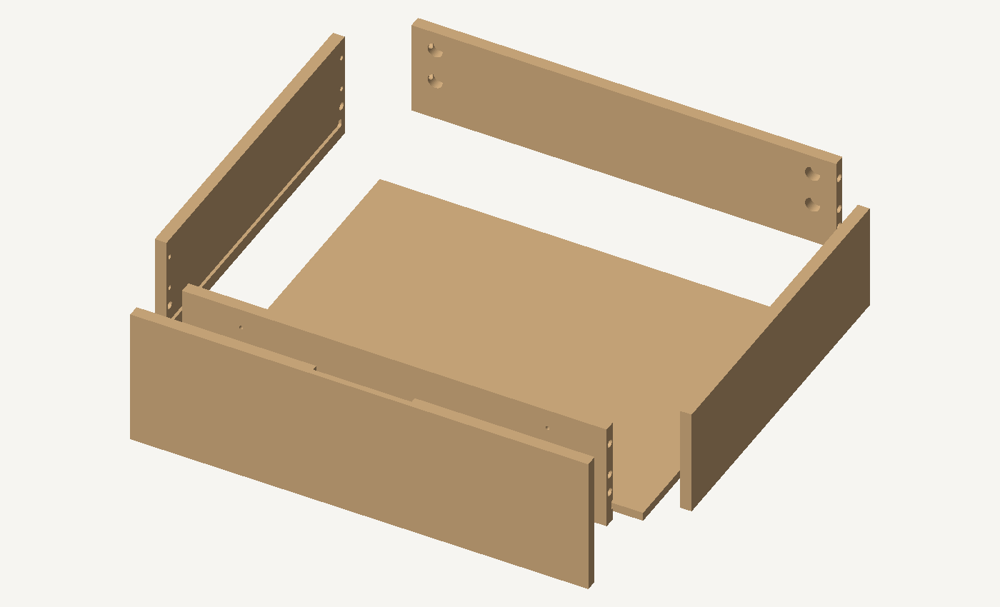

# Ящик v13: проверяемая геометрия присадки

Это исправление черновика v12 после замечания владельца: присадка должна быть показана в 3D и иметь размерные привязки от кромок. **v12 не использовать для передачи в изготовление.** Его файлы сохранены как история.

## Открыть

- [Просмотр 3D: выбор детали, отверстия, отступы и глубина](ПРОСМОТР-3D.html). Работает локально без загрузки библиотек и отправки данных.
- [Собранный ящик GLB](assembled.glb) и [разнесённые детали GLB](exploded.glb).
- [Размерные привязки PDF](Размерные-привязки-v13.pdf): базы U0/V0, расстояния до осей, сторона обработки, глубины и сечения.
- [Отчёт проверки 3D](ПРОВЕРКИ-3D.json) и [исходные размеры и операции](МОДЕЛЬ-И-ОПЕРАЦИИ.json).

## Что действительно проверено

В шести деревянных деталях построены 50 заданных операций. Для каждого контрольного объёма проверено, что он пересекает исходную заготовку, а после обработки внутри этого объёма древесины не остаётся. Все итоговые детали замкнуты и имеют положительный объём.

Проверены совпадение 12 пар осей соединений стенок и 4 осей крепления фасада, отсутствие объёмных пересечений деревянных деталей и отсутствие непредусмотренных пересечений операций. Пересечения кармана эксцентрика с каналом штока, а также сквозного отверстия с его зенковкой являются предусмотренными.

Зенковки теперь имеют коническую форму 90°, а пазы боковин - окончания R3. У заднего хвата фасада также построены нижние углы R3 с выходом инструмента за верхний торец. Это геометрия вырезов, а не нарисованные поверх поверхности обозначения.

Для дерева проверены по 101 положению на пяти шагах сборки: передняя стенка, задняя стенка, дно с вводом сбоку, правая боковина и фасад. Это дискретная проверка выбранных движений деревянных деталей; она не доказывает возможность сборки с реальной фурнитурой.

PDF, GLB и просмотр используют один набор размеров и операций. У операции один идентификатор во всех представлениях. В отчёте записаны контрольные суммы GLB, а на листах PDF указан префикс суммы собранной модели.

## Что не проверено и не выпущено

Реальные эксцентрики, штоки, замки и направляющие не смоделированы. Четыре наклонных пилота замков на ящик и крепление направляющих остаются незаданными операциями, поэтому данный ящик ещё нельзя заказывать как полностью обработанный комплект. Не проверены доступ отвёртки, момент затяжки, посадки с фактической толщиной и отделкой, прочность и нагрузка.

Показан один ящик для условной ширины отсека LW473; в текущем наполнении таких ящиков два. Новый дверной вариант может изменить ширину отсека: тогда этот узел пересчитывается. Это не 3D-проверка всех деревянных деталей шкафа, основания и дверей.

## Решение о дверях

Владелец выбрал объёмные двери с хранением и врезными торцевыми петлями по новым фото. Выбор сохранён для следующего варианта. Точный артикул петель, сечение обрамления и карманы под петли пока не выбраны. Дополнительная пара ящиков и подсветка автоматически не добавлялись. Габариты остаются 1000 × 1800 × 500 мм, высокое основание, без колёс.

## Правило дальнейшей работы

Для каждого узла сначала согласуется конкретная фурнитура и её монтажный чертёж. Затем все вырезы строятся в общей 3D-сборке и проверяются вместе с фурнитурой, допусками, доступом инструмента и порядком монтажа. Только после этого выпускаются производственные чертежи с размерными привязками, ведомость деталей и обновлённая раскладка. Отдельная таблица координат и отсутствие пересечений деревянных панелей не считаются достаточной проверкой готовности.

Источники размеров фурнитуры сохранены в поле sources файла МОДЕЛЬ-И-ОПЕРАЦИИ.json. Полные сторонние каталоги в этот пакет не включены.
