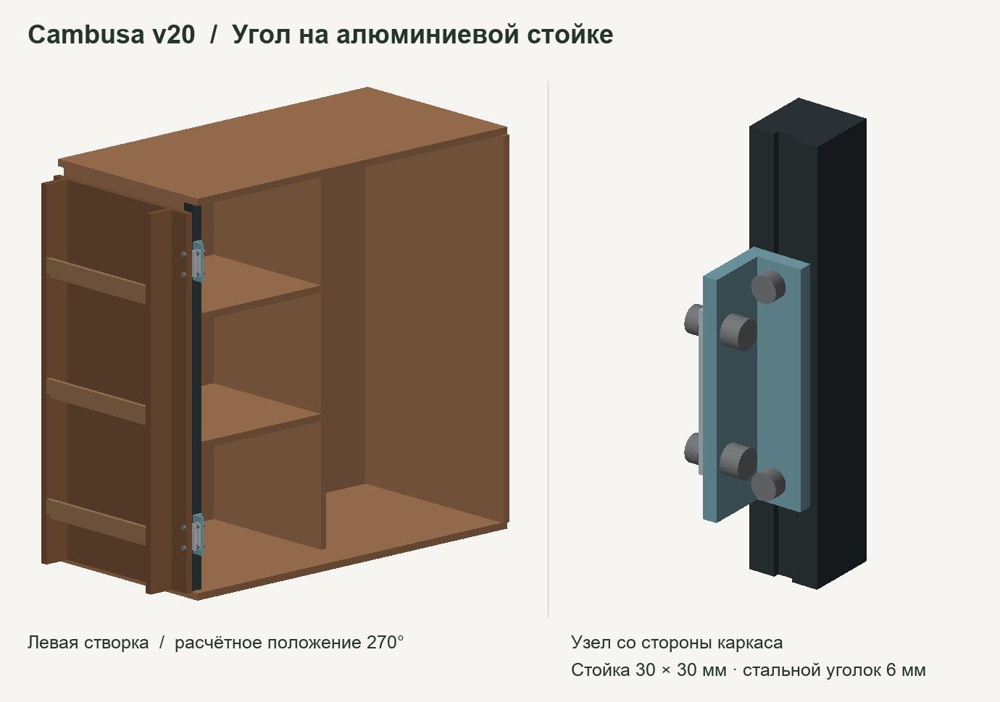

# Cambusa v20 · угол на алюминиевой стойке

Цифровой макет левого угла в масштабе 1:1. Сохранила створку с лотками, высоты двух петель и расчётную ось из [деревянного угла v19](../cambusa-hybrid-v19-corner/README.md). В модели видна левая створка и окружающие детали корпуса.



[Закрыто, GLB](closed.glb) · [Открыто на 270°, GLB](open-270.glb) · [Протокол проверки](ПРОВЕРКА.json) · [Сборка модели](../../scripts/build_aluminum_corner.py)

## Крепление

- Если совместить центр бокового паза стойки 30 × 30 мм с рядом крепёжных отверстий DIRAK v19, габарит стойки заходит в закрытую створку на 14,5 мм по ширине.
- В рабочей геометрии передняя грань стойки находится на 14,5 мм позади внутренней пласти закрытой двери. Кронштейн выносит площадку под петлю вперёд. На каждую петлю приходится один стальной уголок с полками 25 × 31 мм, высотой 96 мм и толщиной стенок 6 мм. Размеры описывают макет.
- Две точки крепления уголка приходятся на передний паз профиля под гайки M6. Ещё две точки соединяют уголок с неподвижной частью петли. На левую створку нужны два одинаковых уголка. Для правой понадобятся зеркальные.
- Возможный комплект для образца — профиль и T-гайки одной серии. Каталог указывает LNHRN8-30-6 среди совместимых гаек для LCF8-3030. [Профиль MISUMI LCF8-3030, паз 8 мм](https://in.misumi-ec.com/vona2/detail/110310655289/?HissuCode=LCF8-3030-4000) · [T-гайка MISUMI LNHRN8-30-6](https://in.misumi-ec.com/vona2/detail/110310154439/?HissuCode=LNHRN8-30-6)

## Что проверено

В исходной модели нет объёмных пересечений между деталями при 0°, 90°, 180° и 270°. Экспортированные GLB в положениях 0° и 270° повторно прочитаны и проверены. Через восемь совмещённых отверстий Ø6,6 мм на двух кронштейнах проходит проверочный цилиндр Ø6,4 мм. Для головок винтов заложен габарит Ø11 × 6 мм.

На всём ходе створки проверены проекции деталей с учётом высоты. Для стойки взят полный наружный габарит. С шагом 0,125° измеренный минимум составил 1,50 мм. После вычета максимального возможного перемещения между проверенными положениями расчётная нижняя граница зазора составляет около 0,95 мм.

## Что осталось проверить перед раскроем

Модель петли пока построена по плоским участкам из каталога. Положение оси относительно монтажных плоскостей принято по v19. При зазоре около миллиметра форма шарнира, точная ось и допуски сборки имеют значение. [Петля DIRAK 267-9004.00-00000](https://products.dirak.com/en/products/hinges/267-9004.00-00000-hinge/) · [Чертёж DIRAK, стр. 27](https://www.dirak.at/uploads/4aaYA9mc/DIRAKHingesc.pdf#page=27)

Для контрольной сборки нужны отрезок выбранного профиля с его T-гайками, два кронштейна и реальная петля на каждом уровне. Сначала следует сверить посадку крепежа и ход пустой створки, затем сравнить провисание и люфт с деревянным углом при одной и той же загрузке. У отверстия в дверной кромке по-прежнему остаётся 3,7 мм фанеры, поэтому прочность самой створки требует отдельной проверки. Каркас целиком, жёсткость шкафа и пегборд в этот расчёт не входили.

## Повторить проверку

Из корня репозитория с зависимостями из `requirements.txt`:

```sh
python3 scripts/build_aluminum_corner.py
```
