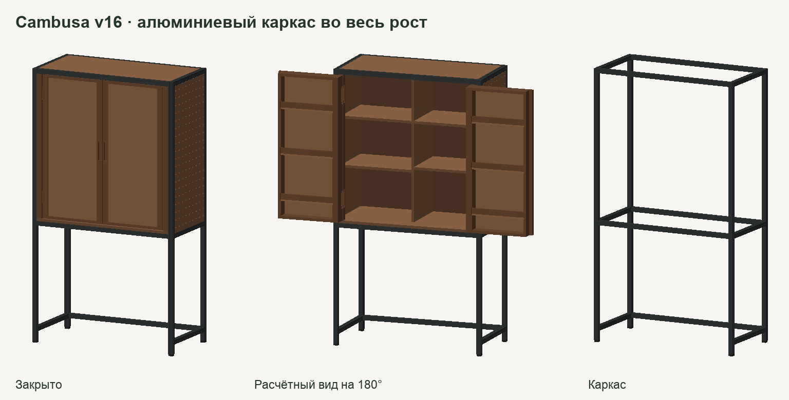

# Cambusa v16 — алюминиевая рама во всю высоту

[Модель закрытая](closed.glb) · [Открытая](open.glb) · [Отдельная рама](frame.glb) · [Ведомость](planning/BOM.md) · [Карты листов](planning/cut-plan.svg)

Габарит шкафа 1000 × 1800 × 500 мм. В раме четыре цельные стойки, поперечины у пола, под корпусом и сверху. Верх и днище вписаны в раму. Чёрный профиль 30 × 30 мм показан по наружному габариту с условной геометрией пазов. Конкретную серию, тип соединителей и жёсткость нужно подтвердить. [Пример промышленного профиля Bosch Rexroth](https://www.boschrexroth.com/en/de/p/strut-profile-3842990723/)

| Деталь | Количество | Номинальная длина, мм |
|---|---:|---:|
| Вертикальная стойка | 4 | 1788 |
| Поперечина по ширине | 5 | 940 |
| Поперечина по глубине | 6 | 440 |

Длина стоек учитывает эскизные 12 мм на опоры. Деревянный корпус начинается на высоте 800 мм. Правая боковина между профилями имеет 171 отверстие. Карманы HES3D-120BL сохранили исходную глубину и вертикальные базы. Петли сидят в деревянных стойках. Эти стойки смещены внутрь на 31 мм, включая 1 мм до профиля. Верхняя поперечина укоротила дверцы по высоте на 12 мм. Размер створки v16 — 426,5 × 946 × 85 мм.

В номинальной сборке проверены все пары деталей с пересекающимися габаритами в закрытом и расчётном открытом положениях. Пересечений объёмов не выявлено. До внутренних полок остаётся 17 мм при закрытых пустых дверях. Проход под отложенные ящики — 424 мм. [Координаты вырезов и результаты](ПРОВЕРКА.json)

Геометрия крайних положений не задаёт траекторию многорычажной петли. Для выпуска обработки нужны проверка на образце и проект разъёмных соединений. Допустимую нагрузку и устойчивость следует проверить вместе с опорами и креплением к стене.
