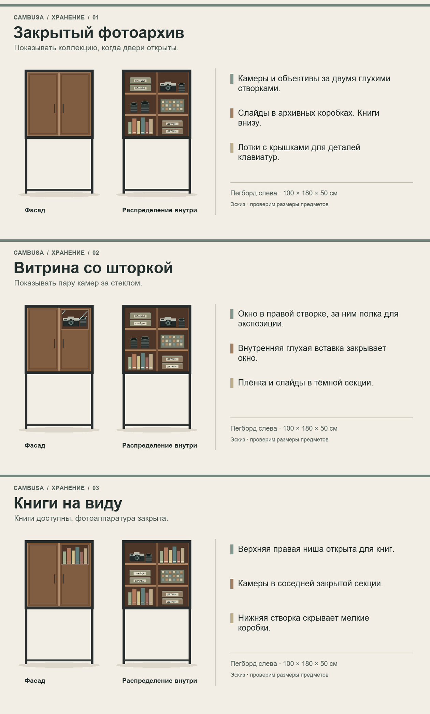

# Хранение в Cambusa v17

Три схемы фасада и наполнения. На правых рисунках показаны зоны хранения без дверей. Геометрия стекла, ячеек и коробок пока эскизная.

| Вариант | Что видно | Что остаётся закрытым |
|---|---|---|
| [01 · Закрытый фотоархив](01-solid.png) | Камеры и книги видны при открытых створках | Вся коллекция при закрытых дверях |
| [02 · Витрина со шторкой](02-glass.png) | Одна или две камеры в верхней правой секции за стеклом, окно можно закрыть глухой вставкой | Остальная оптика, слайды и мелкие детали |
| [03 · Книги на виду](03-books.png) | Книги в верхней правой нише постоянно, камеры видны при открывании | Камеры, оптика и коробки |

- **Камеры и оптика.** Центральные полки и закрывающиеся боксы или отдельная секция с собственным уплотнением. Пегборд сквозной, поэтому глухие фасады сами по себе оставляют путь пыли. Для витрины нужен собственный контур по периметру стекла. За левой стенкой можно предусмотреть глухой экран со свободным карманом для крючков, если это понадобится для большой закрытой секции.
- **Плёнка и слайды.** Закрытые коробки в тёмной части шкафа. Для слайдов подойдут бескислотные коробки или полипропиленовые страницы, рассчитанные на фотографии. Упаковку для оригиналов проверять по PAT. [Library of Congress](https://ask.loc.gov/preservation/faq/422211) · [Canadian Conservation Institute](https://www.canada.ca/en/conservation-institute/services/preventive-conservation/guidelines-collections/photographic-materials.html)
- **Мелочёвка для клавиатур.** Подписанные съёмные лотки с ячейками и крышками под свитчи, кейкапы и винты. На дверных полках глубиной около 58 мм уместятся лёгкие аксессуары вроде крышек и салфеток.
- **Книги.** Основное место на нижнем уровне. В варианте 03 сверху открытая ниша под несколько книг, остальная полка ниже. Нагрузка на полки проверяется отдельно.

Нынешние средние полки глубиной 357 мм. Внутренняя ширина каждой секции около 473 мм, проём спереди 424 мм. Для проверки посадки нужны размеры самого длинного объектива, самой высокой камеры в сборе, коробки со слайдами и самой большой книги. [Задача #4](https://github.com/padington/cambusa-cabinet/issues/4)
