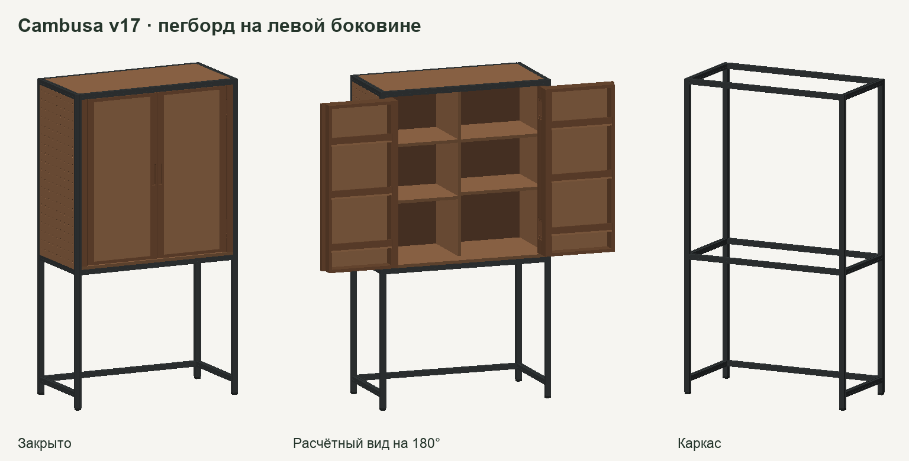

# Cambusa v17 — левый пегборд

[Вращаемая модель](https://padington.github.io/cambusa-cabinet/) · [Закрыто](closed.glb) · [Расчётный вид на 180°](open.glb) · [Каркас](frame.glb) · [Ведомость](planning/BOM.md) · [Карты листов](planning/cut-plan.svg)

Пегборд на левой стенке при взгляде спереди. Панель с 171 сквозным отверстием в тех же габаритах, справа глухая боковина. Габариты шкафа 1000 × 1800 × 500 мм. Размеры каркаса, створок и проёма под будущие ящики взяты из [v16](../cambusa-frame-v16/КОНСТРУКЦИЯ.md).

## Комплектность и пересечения

[Аудит GLB](АУДИТ-3D.json) сверяет 53 детали по ID с ведомостью, проверяет замкнутость объёмов, размеры и положение в закрытом и расчётном открытом состоянии. Пересечений объёмов выше 0,08 мм³ не найдено. В отчёте отдельно перечислены пары, чьи габаритные коробки касаются. Все 171 отверстие подтверждены в левой панели. Справа отверстий нет.

Петли, соединители, крючки, фиксаторы и содержимое ещё не смоделированы. Проверка полного хода, допусков, инструмента и нагрузки остаётся в [задаче #1](https://github.com/padington/cambusa-cabinet/issues/1).

## Угол 270°

[Схема сверху](ход-270.svg) · [Результаты расчёта](ХОД-270.json) · [Задача #2](https://github.com/padington/cambusa-cabinet/issues/2)

В геометрическом варианте с левой осью в координатах X=0, Y=−5 мм проверили положения от 0 до 270° с шагом 0,5°. Проекции деталей двери проверены против консервативных габаритов корпуса с учётом высоты. В этих положениях пересечений нет. Расчётный зазор между траекториями двух створок не меньше 3,54 мм. В проверке поворачивается геометрия створок вокруг выносной оси. Форма и присоединение самой петли требуют отдельной разработки.

При 270° створка выступает за габарит шкафа на 92 мм сбоку. В выбранной схеме ось находится примерно в 71 мм от ближней кромки створки. Между осью и дверью потребуется выносной кронштейн. Его геометрию и болтовое крепление нужно проверить вместе с петлёй.

Текущие врезные петли HES3D-120BL рассчитаны на 180°. Наружная EMKA 1056-U18 рассчитана на 270° и служит примером отдельного класса петель. Нужно проверить, можно ли смонтировать её или выносной узел на существующие раму и створку с требуемой нагрузкой. [Sugatsune](https://www.sugatsune.com/3-way-adjustable-concealed-hinge-black-hes3d-120bl/) · [EMKA](https://www.emka.com/products/1056-u18)

## Наполнение

[Три коллажа и размеры для следующего шага](storage/README.md). v17 показывает базовый шкаф с глухими рамочными дверями. Наполнение, стекло и шторка показаны в эскизах.
