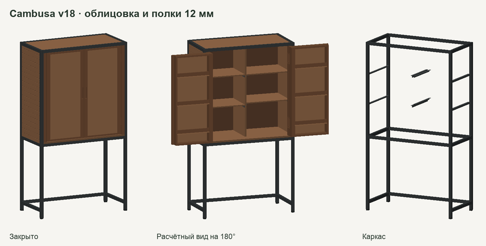

# Cambusa v18 — тонкие панели в алюминиевом каркасе

[3D онлайн](https://padington.github.io/cambusa-cabinet/variants/v18/) · [Закрытый шкаф](closed.glb) · [Открытый шкаф](open.glb) · [Рама и опоры полок](frame.glb) · [Раскладка](planning/cut-plan.svg) · [Ведомость](planning/BOM.md)

Вариант для сравнения с [v17](../cambusa-frame-v17/КОНСТРУКЦИЯ.md). Наружные габариты 1000 × 1800 × 500 мм. Верх и обе боковины утоплены на 6 мм относительно профиля. Это даёт одинаковый отступ панелей при прежних внутренних базах.

| Толщина фанеры | Детали |
|---|---|
| **12 мм** | Верх, боковины, четыре внутренние полки, филёнки и полки створок |
| **9 мм** | Задник и бортики полок дверей. Заготовки помещаются на одном листе |
| **18 мм** | Днище, центральная перегородка, поперечины дверных рамок |

Рамные стойки створок и детали под врезку петель идут отдельными деревянными заготовками. Тонкие полки опираются на два уголка 20 × 20 × 2 мм каждая. Наружные уголки укорочены до 422 мм, чтобы проходить между передней стойкой петли и задником. С каждого конца заложено по 9 мм для присоединения к раме. Внутренние уголки длиной 357 мм идут вдоль перегородки. В модели подтверждён контакт опор с низом полок. Узел крепления и расчёт самих уголков требуют отдельной проверки.

## Что даёт переход

- **−6,55 кг** по сравнению с v17, с учётом +0,64 кг алюминиевых уголков и более толстого задника. Это разница масс моделируемых деталей при 680 кг/м³ для берёзовой фанеры и 2700 кг/м³ для алюминия. Крепёж пока не определён.
- **4 листа вместо 5** при прежнем формате 1525 × 1525 мм. Раскладка v18 использует два листа 12 мм, один 9 мм и один 18 мм. Добавляются две заготовки алюминиевого уголка по 2 м.
- **61 деталь** в экспортированной модели. Сверены габариты, расположение опор и крайние положения дверей. Пересечений объёмов выше принятого допуска не найдено. [Аудит 3D](АУДИТ-3D.json)

## Что известно о полках

Для фанеры с характеристиками выбранного эталона расчётный кратковременный прогиб полки 473 × 357 × 12 мм при равномерных 15 кг около **0,64 мм**. Для 18 мм в той же схеме около **0,18 мм**. Расчёт предполагает жёсткие опоры по краям и учитывает собственный вес полки. Отдельно остаются податливость уголков и креплений, длительный прогиб, точечные нагрузки и прочность узлов. Тяжёлые книги в этой компоновке логично ставить на днище 18 мм над рамой. [Таблица расчёта](МАССА-И-ПОЛКИ.json) · [Декларация характеристик Metsä Wood](https://www.metsagroup.com/contentassets/2e9ddda886f04453825068d3b37afcdc/uk_doc_metsawood_birch_plywood_pf_2022-11-07.pdf) · [Плотность берёзовой фанеры](https://www.metsagroup.com/contentassets/8a5519dc6e534fcfa99c06759fbb8bad/metsa_wood_birch_plywood_product_datasheets_en.pdf)

v18 — вариант для сравнения. Проектирование креплений и проверка нагруженной сборки нужны до заказа.
