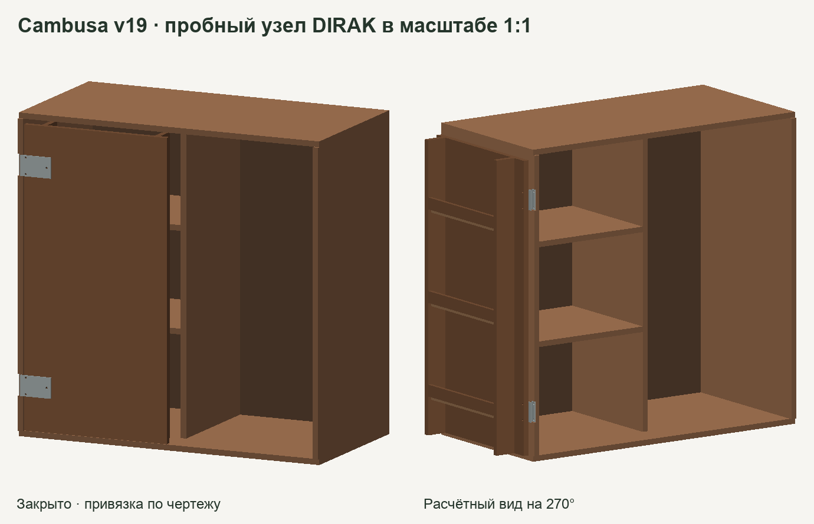

# Cambusa v19 — пробный угол гибридного корпуса

Проверочный узел в натуральную величину. Левая створка 475,5 × 946 × 85 мм, боковина и несущие детали из фанеры 18 мм, задник и лотки 12 мм. Створка крепится к деревянной боковине. Алюминиевое основание под коробом остаётся за пределами этого узла.

[Закрыто, GLB](closed.glb) · [Положение 270°, GLB](open-270.glb) · [Шаблон сверки 1:1](контроль-1к1.svg) · [Числовой протокол](ПРОВЕРКА.json)

## Что изменилось и что проверено

- Взята серийная стальная **DIRAK 267-9004.00-00000** на 270°. Два отверстия неподвижной половины, три створочной, Ø6,6 мм. Для двух петель на высотах 960 и 1640 мм в 3D построены десять сквозных каналов. Цилиндры Ø6,4 мм прошли сквозь плоские части планок и фанеру по общим осям. [Каталог DIRAK, стр. 532](https://www.dirak.at/uploads/4aaYA9mc/DIRAKHingesc.pdf#page=27)
- Неподвижная планка садится в выборку **6 мм** в боковине 18 мм. За выборкой остаётся 12 мм. Центры отверстий на боковине в 8 мм от её передней кромки. Центры на створке в 7 и 77 мм от левой кромки. В этой компоновке переходные пластины не требуются. Узел крепления и прочность фанеры на расстоянии **3,7 мм от края ближайшего отверстия до кромки** остаются под проверкой.
- В 3D при 0°, 90°, 180° и 270° объёмных пересечений проверяемых тел нет. Для номинальной оси проверен ход с шагом 0,125° по консервативным проекциям. Минимальный зазор на выборке 1,5 мм. Нижняя граница между соседними отсчётами — около 0,95 мм при той же идеализированной геометрии. Шарнир, фаски планок, головки винтов и допуски требуют точного CAD.
- Ось слева **X=−3,5 мм, Y=−19 мм** от левого края и передней плоскости короба. Вынос от оси до каждой монтажной плоскости пока **9,5 мм**, это симметричная интерпретация размера 19 мм на каталожной схеме, которую нужно измерить на образце. В выгрузке производителя требуется вход. [Запись точной модели петли](https://dirak.partcommunity.com/3d-cad-models/?catalog=dirak&part=267-9004.00-00000&partfixed=false)

## Как принять пробный узел

1. Получить STEP или измерить реальную петлю. Сверить вынос оси, положение плоских половин в закрытом положении и габарит бочонка. Заново проверить в 3D полный ход с винтами, шайбами, гайками и доступом инструмента.
2. Сделать один закреплённый полноразмерный стенд с двумя петлями и будущей кромкой створки. Контрольный шаблон печатается в масштабе 100%. Проверить квадрат 50 × 50 мм и наложить реальную петлю до выпуска обработки.
3. Измерить зазоры, провисание свободного края и люфт сначала пустой створки, затем с выбранным содержимым. Для первого инженерного сравнения принят сценарий 3 кг на дальнем крае полки. По модели деревянная створка весит около 7,87 кг при расчётной плотности 680 кг/м³, момент в этом сценарии около 34 Н·м до массы металла. Рабочую нагрузку и допустимые прогибы назначить после проверки крепления.
4. Только после проверки угла перенести узел в полный шкаф и проверить собранный короб, алюминиевое основание, устойчивость и порядок самостоятельной сборки.

**Статус выпуска.** Номинальная геометрия пробного узла проверена. Реальная петля и нагруженный образец остаются в [задаче #2](https://github.com/padington/cambusa-cabinet/issues/2). Припасовка на объекте, присадка полного комплекта и заказ по этим файлам не согласованы.

Пересборка из корня репозитория с установленными зависимостями `python scripts/build_hybrid_corner.py`.
