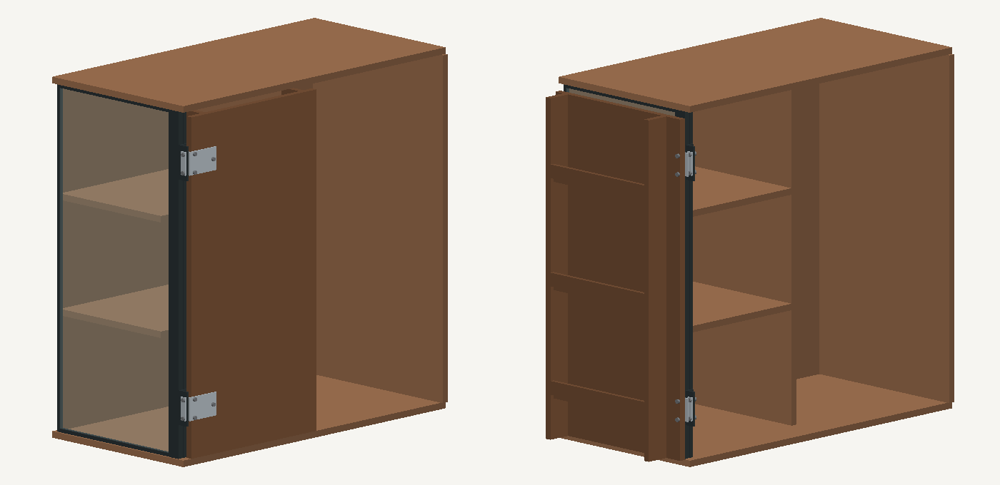

# Cambusa v21 · левая стенка из стекла

В модели левого угла v20 заменила фанерное заполнение на прозрачное стекло. Панель удерживают два периметральных борта с мягкими прокладками. Внутренний борт в готовом узле должен разбираться на планки, чтобы стекло можно было поставить после сборки каркаса. Вес панели передаётся на две нижние опорные колодки. Крепление петель и полок должно передавать нагрузку на раму. К стеклу крепёж не привязан.



[Закрытый угол, GLB](closed.glb) · [Угол с дверью на 270°, GLB](open-270.glb) · [Протокол](ПРОВЕРКА.json) · [Фурнитура и поставщики](ФУРНИТУРА-СПБ.md)

Стекло в макете 429 × 956 × 6 мм. Это размер для текущей геометрии, его нужно пересчитать по посадке выбранных планок и фактическому проёму. Для заказа рассматриваем прозрачное закалённое стекло с полированной кромкой без отверстий. [Изготовление в Петербурге, GlassStroy](https://glassstroy.ru/product/zakalennoe-steklo-6-mm/)

На полном расчётном ходе нижняя граница зазора до остекления и прижимов 8,45 мм. Общий минимум 0,95 мм по-прежнему задаёт петлевой узел v20. Проверка относится к одной створке и габаритам фурнитуры. Для выпуска под заказ ещё нужны реальная петля и прижимы, проверка нагруженной створки и 3D-сборка всего каркаса.

Воспроизведение с зависимостями из `requirements.txt`:

```sh
python3 scripts/build_glass_corner.py
```
