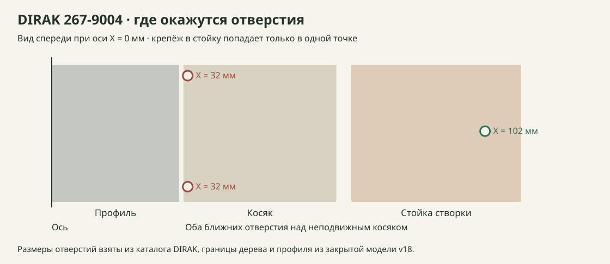

# Проверка петли 270° и каркаса Cambusa

**Статус выпуска.** комплект шкафа для заказа пока не подтверждён. Проверены отверстия трёх серийных петель по размерным чертежам, исходные детали v18 и геометрический коридор под возможный адаптер. Сборка с реальной петлёй остаётся в [задаче #2](https://github.com/padington/cambusa-cabinet/issues/2).

## Что встанет на v18

Стойка левой створки занимает X **70,5–110,5 мм**. X отсчитывается от левого наружного края рамы. Показанное ранее положение 270° использовало условную ось X=0, Y=−5 мм. Ниже проверены центры крепежа при этой оси. Зеркально для правой створки.

| Петля | Центры крепежа створочной половины от оси | Попадание в стойку |
|---|---|---|
| **EMKA 1056-U18**, наружная, 270° | Два на 28 мм по X, по Z ±15 мм | 0 из 2 |
| **DIRAK 218-9210**, короткая и длинная литые половины, 270° | Два на 45 мм по X, по Z ±18 мм | 0 из 2 |
| **DIRAK 267-9004.00-00000**, стальная длинная планка, 270° | Два на 32 мм по X при Z ±25,5 мм, один на 102 мм по X при Z=0. Отверстия Ø6,6 мм | 1 из 3. Два ближних над неподвижным косяком |
| **Sugatsune HES3D-120BL**, скрытая врезная | Карманы уже в модели v18. Монтажная схема показывает 180° | Направление для 180°, требуется сборка с петлёй |

[Чертёж EMKA](https://www.emka.com/web/image/product.image/95667/image_1024/Drawing%20Image%201?unique=90714aa) · [Каталог DIRAK, страницы 520 и 532](https://www.dirak.at/uploads/4aaYA9mc/DIRAKHingesc.pdf#page=27) · [Монтажная схема Sugatsune](https://www.sugatsune.com/content/site-assets/Instructions/0522-7_hes3d120e.pdf)

## Что проверено для выноса DIRAK

Проверила геометрическую схему, где две петли на створку стоят на высотах **960 и 1640 мм**. Номинальная ось слева **X=−15,5 мм, Y=−20 мм**. X отрицателен наружу, Y отрицателен вперёд. Опорные поверхности предполагают 9,5 мм от оси до монтажной плоскости. Это половина размера 19 мм из изображения сложенных планок, принятая по симметрии для расчёта. Размер следует измерить на петле или взять из её CAD.

- **На створке** проверена схема ступенчатой планки X=9–107 мм с 6-миллиметровой частью для крепления петли. При номинальной оси крепёж петли находится на X=16,5 и 86,5 мм. Внешняя часть держит ближние отверстия, внутренняя опирается на деревянную стойку X=70,5–110,5. Понадобится заново спроектировать стойку без врезок под HES и проверить крепление планки к ней.
- **На алюминии** крепёж петли при этой оси выходит на Y=−1 мм, на 16 мм вперёд от оси бокового паза модели Y=15 мм. Нужна фиксированная пластина с двумя раздельными рисунками крепления. Положение винтов и закладных выбирается после проверки сечения реального профиля.
- **Ход** проверен с шагом 0,125° для деталей створки, обеих переходных пластин и плоских участков планок петли за пределами 14 мм от оси. В трёх проверенных вариантах вылета 8, 9,5 и 11 мм пересечения проверенных габаритов в проекциях не выявлены. При 11 мм плоские габариты местами приближаются примерно до 1 мм. В расчёте отсутствуют бочонок, головки и тела винтов, локальная форма у оси и производственные допуски. [Протокол с числами](ПРОВЕРКА.json)

Деревянная створка v18 весит по модели **7,68 кг** до металла. Сценарий с 3 кг аксессуаров на дальнем крае даёт **105 Н веса, 36 Н·м момента** и примерно **53 Н радиальной реакции на каждой из двух петель** при разносе 680 мм. Это расчёт нагрузки для выбора крепления. Грузоподъёмность петли и узла по нему не назначается. Силы от самих адаптеров, ударов и перекосов добавляются отдельно.

**Вывод по креплению.** DIRAK 267-9004 — конкретный кандидат на проверку. В геометрии v18 он требует по две переходные детали на каждую петлю, всего восемь на четыре петли. Для производства нужны CAD или образец, уточнение вылета и бочонка, крепёж к стойке и профилю, а затем проверка под нагрузкой. Выгрузка CAD в проверенном интерфейсе требует входа. [Карточка DIRAK](https://products.dirak.com/en/products/hinges/267-9004.00-00000-hinge/) · [Запись CAD для 267-9004](https://dirak.partcommunity.com/3d-cad-models/?catalog=dirak&part=267-9004.00-00000&partfixed=false)

## Даёт ли полный алюминиевый каркас пользу

| Критерий | Что показывает v18 | Что сравнить |
|---|---|---|
| Толщины | Три: 9, 12 и 18 мм. Сведение 9 и 12 к общему листу даёт **12 и 18 мм**, по тем же контурам получается три листа 12 и один 18 мм. Надо изменить пазы бортиков и узел задника | Корпус из фанеры тоже можно сделать из двух толщин |
| Жёсткость | Профиль даёт непрерывные опоры и точки монтажа. Боковую жёсткость задают соединения и работа закреплённого задника на перекос | Сравнить боковое перемещение и возврат после разгрузки у образцов с одинаковой схемой опоры и нагрузки |
| Фурнитура | В v18 **4 стойки, 11 поперечин, 22 присоединяемых конца, 8 уголков полок**. Это геометрические позиции, а фактическое число креплений ещё неизвестно. Адаптация DIRAK добавляет пластины | У фанерного короба с пазами и задником часть отдельных уголков можно убрать. Сравнивать после ведомости соединений и разборной сборки |

У полного каркаса есть смысл, когда нагрузка от дверей, полок и опор действительно передаётся через одни и те же стойки, панели можно сделать тоньше, а узлы крепятся доступно снаружи. В v18 петли всё ещё привязаны к деревянным косякам. Для цели «меньше деталей и проще сборка» первым контрольным вариантом предлагаю **фанерный короб 12/18 мм на алюминиевом основании**. Проверять его с той же петлёй и с переработанной наружной кромкой створки. Это сравнительный вариант, геометрия кромки ещё не согласована.

## Условия готовности

1. Зафиксировать артикул петли и измерить её корпус, ось и плоскости крепления. Разложить все отверстия, винты, закладные и доступ ключа по деталям с отступами.
2. Построить один полноразмерный угол с настоящей створкой или нагрузочным эквивалентом. Проверить движение до 270°, зазоры при перекосе и удержание двери в нужных положениях. Записать осадку и люфт до и после нагрузки.
3. Для выбранного корпуса проверить боковую жёсткость, опоры полок, крепление к стене и полный порядок сборки. После этого выпустить ведомость крепежа и обработку деталей с привязками.
